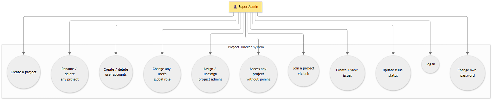
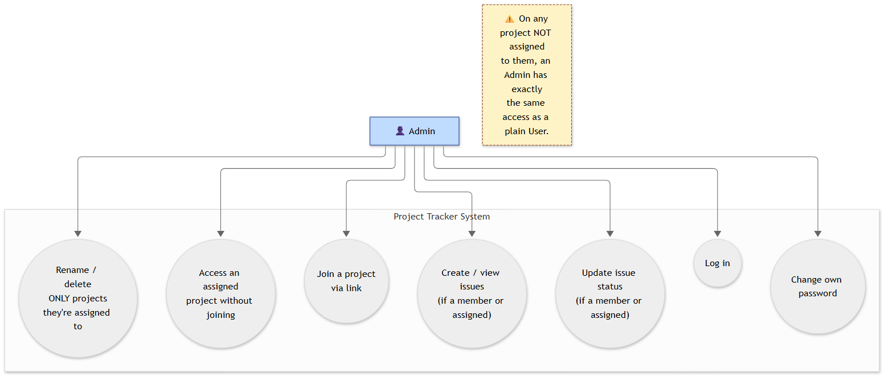
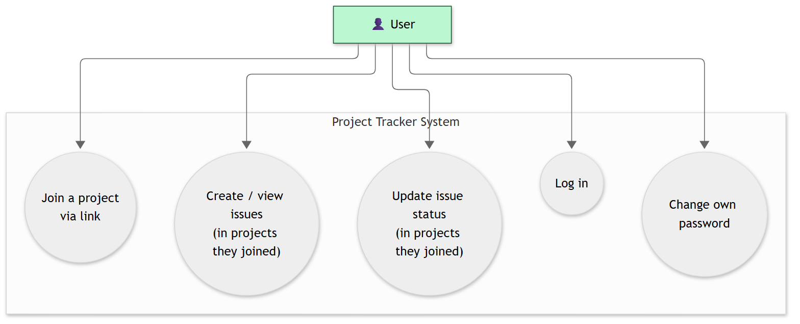
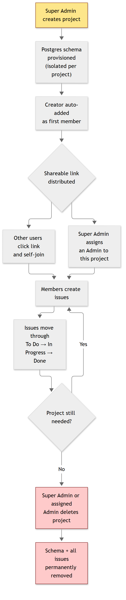
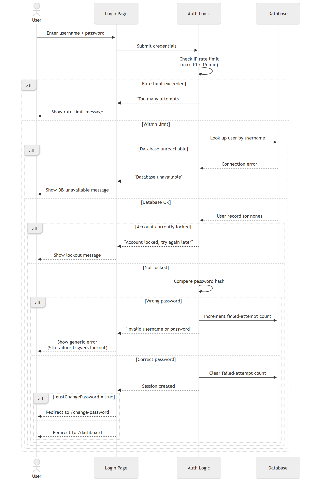

# Project Tracker — Feature & Capability Overview

A JIRA-like, multi-tenant project/issue tracker. Each project gets its own
isolated Postgres schema. Access is entirely admin-provisioned — there is
no public signup.

This document describes **what the application can and cannot do today**,
in business terms, so it can be used for onboarding, planning, or
stakeholder review without reading code. See `docs/diagrams/` for the
source `.mmd` files behind every diagram below, and `PROGRESS.md` for the
engineering change history.

---

## Diagrams

**Who can do what** (one diagram per role):

| Super Admin | Admin | User |
|---|---|---|
|  |  |  |

**A project's life, start to finish:**

**What actually happens on login** (including every error path):

---

## 1. Roles & Access Model

Three global roles exist on every user account:

| Role | Scope |
|---|---|
| **SUPER_ADMIN** | Full control over the entire system — every project, every user, every setting. |
| **ADMIN** | Elevated control, but **only** over projects a SUPER_ADMIN has explicitly assigned them to. On any project they are *not* assigned to, an ADMIN behaves exactly like a USER. |
| **USER** | Normal member. Can join projects and work on issues, nothing administrative. |

There is also a **per-project membership** list, separate from the global
role: anyone (any role) can join any project by visiting its shareable
link, and becomes a "member" of that project.

### Permission matrix

| Capability | SUPER_ADMIN | ADMIN (assigned to this project) | ADMIN (not assigned) | USER |
|---|:---:|:---:|:---:|:---:|
| Create a new project | ✅ | ❌ | ❌ | ❌ |
| Rename / delete a project | ✅ (any) | ✅ (that project only) | ❌ | ❌ |
| View / access a project without joining | ✅ | ✅ (that project only) | ❌ | ❌ |
| Join a project via its link | ✅ | ✅ | ✅ | ✅ |
| Create / view issues (once a member, or with manage access) | ✅ | ✅ | ✅ (if a member) | ✅ (if a member) |
| Update an issue's status | ✅ | ✅ | ✅ (if a member) | ✅ (if a member) |
| Open the Admin console | ✅ | ❌ | ❌ | ❌ |
| Create / delete user accounts | ✅ | ❌ | ❌ | ❌ |
| Change another user's global role | ✅ | ❌ | ❌ | ❌ |
| Assign/unassign project admins | ✅ | ❌ | ❌ | ❌ |

**Guardrails already in place:** a SUPER_ADMIN cannot demote or delete
their own account through the console (prevents accidental lockout), and
a user who still owns a project cannot be deleted until that project is
removed or reassigned.

---

## 2. Account & Login

- **No public sign-up page.** The only way to get an account is for a
  SUPER_ADMIN to create one for you from the Admin console.
- Login is by **username + password** (not email).
- New accounts are created with a **temporary password** and are forced
  to set a new one on first login before they can use anything else.
- Email is **optional** on an account and is purely informational — it is
  never verified, and it is never used to log in or to send anything
  (no emails are sent by the system at all today).
- **Brute-force protections already built in:**
  - 5 wrong passwords in a row locks the account for 15 minutes.
  - No more than 10 login attempts per 15 minutes from the same network
    address, regardless of which account is being tried.
- If the database itself is temporarily unreachable, the login page and
  every page in the app show a clear "database unavailable" message
  instead of a blank or broken screen.

**Not available today:** self-service signup, "forgot password" /
password-reset-by-email, two-factor authentication, logging in with
Google or any other external account, and no way for an admin to look up
or reset a forgotten password (they can only change the *role*, or delete
and recreate the account).

---

## 3. Projects

- Only a **SUPER_ADMIN** can create a new project. On creation, the
  project gets its own fully isolated area of the database — nothing
  about one project's issues is ever stored together with another's.
- Every project has a **shareable link**. Anyone who is logged in and has
  that link can join instantly — there is no approval step and no way to
  make a project "private" today.
- The project creator (always a SUPER_ADMIN) and any SUPER_ADMIN can
  rename or permanently delete the project at any time. A SUPER_ADMIN can
  also hand day-to-day management of a specific project to an ADMIN,
  without giving that ADMIN control over anything else in the system.
- Deleting a project is **permanent and immediate** — it removes the
  project and every issue in it; there is no "trash"/recovery step.

**Not available today:** leaving a project you've joined, removing a
regular member from a project (only *admin assignments* can be removed,
not plain membership), transferring who "owns" a project, archiving a
project instead of deleting it, and searching or filtering the project
list.

---

## 4. Issue Tracking

Each issue has a **title**, an optional **description**, and a **status**
— exactly one of `To Do`, `In Progress`, or `Done`.

- Any member of a project (or an admin with access to it) can create an
  issue and move it through the 3 statuses.
- Issues are listed newest-first, with no pagination — the whole list
  loads at once.

**Not available today:** editing an issue's title/description after
creation (only the status can change), deleting an issue, assigning an
issue to a specific teammate, comments/discussion on an issue, file
attachments, priority levels, due dates, and search/filter/sort on the
issue list.

---

## 5. Admin Console

Visible only to SUPER_ADMIN accounts, at `/admin`.

**User management:**
- View every account (username, name, email, role).
- Change any other user's role (not your own).
- Delete any other user's account (not your own; blocked if they still
  own a project).
- Create a new account with a temp password, optional name/email, and a
  starting role.

**Project oversight:**
- View every project with its member count and currently assigned
  admins.
- Assign a user (who must already hold the ADMIN role) to manage a
  specific project, or remove that assignment.

**Not available today from the console:** editing a user's
username/name/email after creation, resetting another user's password
for them, bulk actions (bulk delete, bulk role change, CSV import),
creating/renaming/deleting a project (project edits happen on the
project's own page, not here), and an audit trail view (the system does
record *who* assigned each project admin internally, but there is no
screen to see that history yet).

---

## 6. Reliability & Error Handling

- If the database connection drops or is misconfigured, the app detects
  this specifically and shows a clear, honest message (both on the login
  screen and as a banner across the app) instead of a generic crash page.
- Rate limits are enforced on login, project creation, and joining a
  project, to slow down automated abuse. Issue creation/updates, password
  changes, and admin actions are not currently rate-limited.

---

## 7. Summary: Known Limitations

For quick reference, the most notable things this application **does not
do today**:

- No public signup, password reset, 2FA, or social login.
- No way to leave a project or remove a regular member from one.
- No project ownership transfer or archiving (delete is permanent).
- No issue editing, deletion, assignment, comments, attachments,
  priorities, or due dates.
- No search, filtering, or pagination anywhere in the app.
- No notifications (email or in-app) of any kind.
- No audit log screen, bulk admin actions, or CSP/security headers
  configuration.
- No dark/light mode toggle (it follows the device's OS setting only).

None of these are bugs — they're simply scope that hasn't been built yet.
See `PROGRESS.md` for what's actively being worked on.
