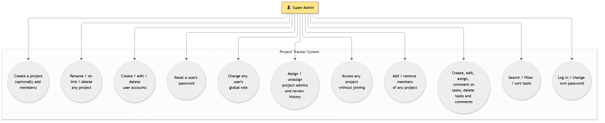
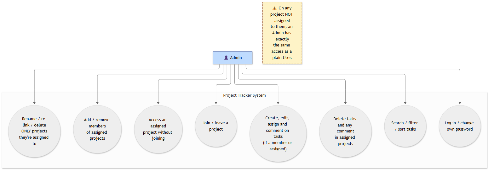
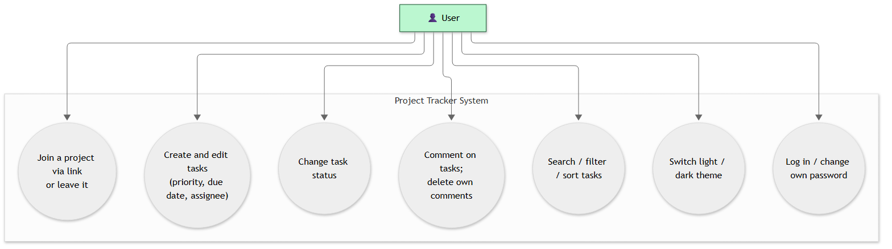
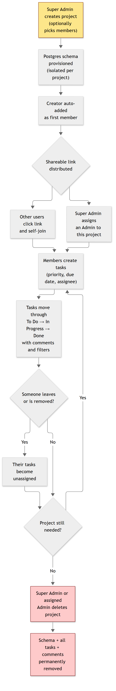
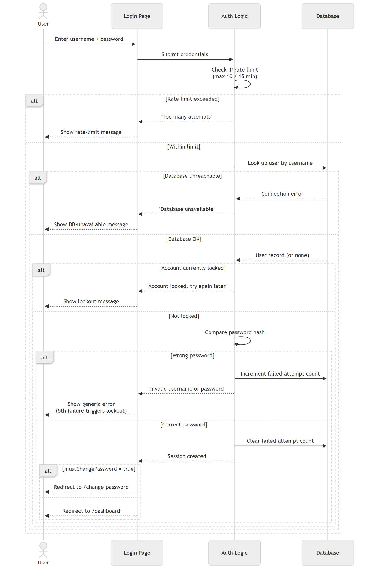

# Project Tracker — Feature & Capability Overview

A JIRA-like, multi-tenant project/task tracker. Each project gets its own
isolated Postgres schema. Access is entirely admin-provisioned — there is
no public signup.

This document describes **what the application can and cannot do today**,
in business terms, so it can be used for onboarding, planning, or
stakeholder review without reading code. See `docs/diagrams/` for the
source `.mmd` files behind every diagram below, and `PROGRESS.md` for the
engineering change history.

---

## Diagrams

**Who can do what** (one diagram per role):

| Super Admin | Admin | User |
|---|---|---|
|  |  |  |

**A project's life, start to finish:**

**What actually happens on login** (including every error path):

---

## 1. Roles & Access Model

Three global roles exist on every user account:

| Role | Scope |
|---|---|
| **SUPER_ADMIN** | Full control over the entire system — every project, every user, every setting. |
| **ADMIN** | Elevated control, but **only** over projects a SUPER_ADMIN has explicitly assigned them to. On any project they are *not* assigned to, an ADMIN behaves exactly like a USER. |
| **USER** | Normal member. Can join projects and work on issues, nothing administrative. |

There is also a **per-project membership** list, separate from the global
role: anyone (any role) can join any project by visiting its shareable
link, and becomes a "member" of that project.

### Permission matrix

| Capability | SUPER_ADMIN | ADMIN (assigned to this project) | ADMIN (not assigned) | USER |
|---|:---:|:---:|:---:|:---:|
| Create a new project | ✅ | ❌ | ❌ | ❌ |
| Rename / delete a project | ✅ (any) | ✅ (that project only) | ❌ | ❌ |
| View / access a project without joining | ✅ | ✅ (that project only) | ❌ | ❌ |
| Join a project via its link | ✅ | ✅ | ✅ | ✅ |
| Create / view / edit issues, assign them, comment (once a member, or with manage access) | ✅ | ✅ | ✅ (if a member) | ✅ (if a member) |
| Delete an issue | ✅ | ✅ (that project only) | ❌ | ❌ |
| Delete a comment | ✅ (any) | ✅ (any, that project) | own only | own only |
| Leave a project | ✅ | ✅ | ✅ | ✅ |
| Add / remove other members | ✅ | ✅ (that project only) | ❌ | ❌ |
| Open the Admin console | ✅ | ❌ | ❌ | ❌ |
| Create / delete user accounts | ✅ | ❌ | ❌ | ❌ |
| Edit a user's username / name / email, reset their password | ✅ | ❌ | ❌ | ❌ |
| Change another user's global role | ✅ | ❌ | ❌ | ❌ |
| Assign/unassign project admins | ✅ | ❌ | ❌ | ❌ |

**Guardrails already in place:** a SUPER_ADMIN cannot demote or delete
their own account through the console (prevents accidental lockout), and
a user who still owns a project cannot be deleted until that project is
removed or reassigned.

---

## 2. Account & Login

- **No public sign-up page.** The only way to get an account is for a
  SUPER_ADMIN to create one for you from the Admin console.
- Login is by **username + password** (not email).
- New accounts are created with a **temporary password** and are forced
  to set a new one on first login before they can use anything else.
- Email is **optional** on an account and is purely informational — it is
  never verified, and it is never used to log in or to send anything
  (no emails are sent by the system at all today).
- **Brute-force protections already built in:**
  - 5 wrong passwords in a row locks the account for 15 minutes.
  - No more than 10 login attempts per 15 minutes from the same network
    address, regardless of which account is being tried.
- If the database itself is temporarily unreachable, the login page and
  every page in the app show a clear "database unavailable" message
  instead of a blank or broken screen.

- A SUPER_ADMIN can **reset another user's password** to a new temporary
  one. The user is forced to choose their own at next sign-in, and any
  lockout is cleared. Passwords are never shown to anyone after being set.
- A SUPER_ADMIN can edit a user's username, name and email after creation.

**Not available today:** self-service signup, "forgot password" by
email, two-factor authentication, and logging in with Google or any other
external account.

---

## 3. Projects

- Only a **SUPER_ADMIN** can create a new project (optionally adding
  members at creation). On creation, the project gets its own fully
  isolated area of the database — nothing about one project's tasks is ever
  stored together with another's.
- Every project has a **shareable link** (`/{slug}`) and opens in its own
  tab with its own navigation. Anyone who is logged in and has the link can
  join instantly — there is no approval step and no way to make a project
  "private" today.
- A SUPER_ADMIN, or an ADMIN assigned to the project, can rename it, change
  its link, add or remove members and delete it. Reserved words (such as
  `login` or `admin`) cannot be used as a link.
- **Members can leave** a project themselves. Whether they leave or are
  removed by a manager, their tasks become unassigned (nothing is lost).
- The dashboard lists the projects you belong to (or all projects for a
  SUPER_ADMIN) with search and pagination.
- Deleting a project is **permanent and immediate** — it removes the
  project and every task and comment in it; there is no "trash"/recovery.

**Not available today:** transferring who "owns" a project, archiving a
project instead of deleting it, and private/invite-only projects.

---

## 4. Issue Tracking

Each task has a **title**, optional **description**, a **status** (`To do`,
`In progress`, `Done`), a **priority** (`Low`, `Medium`, `High`, `Urgent`),
an optional **due date** and an optional **assignee**.

- Any member of a project (or an admin with access to it) can create a
  task, change any of its fields on the task page, and change its status
  quickly from the board.
- Tasks can only be assigned to people who are members of (or admins
  assigned to) that project.
- Every task has a **comment thread**. Comments can be deleted by their
  author or by a project manager.
- The board supports **search** (title and description), **filters**
  (status, priority, assignee, unassigned), **sorting** (newest, oldest,
  recently updated, priority, due date) and **pagination** (25 per page).
- Overdue tasks (past their due date and not Done) are highlighted.
- Only project managers can delete a task.
- Projects created before these features existed upgrade automatically the
  first time they are opened — no manual migration is needed.

**Not available today:** file attachments, labels/tags, sub-tasks,
task history/activity log, @mentions and notifications, bulk edits, and a
kanban (drag and drop) view.

---

## 5. Admin Console

Visible only to SUPER_ADMIN accounts, at `/admin`.

**User management:**
- View every account (username, name, email, role).
- Create a new account with a temporary password, optional name/email and
  a starting role.
- **Edit** a user's username, name and email.
- **Reset** a user's password (temporary password, forced change at next
  sign-in, lockout cleared).
- Change any other user's role (not your own).
- Delete any other user's account (not your own; blocked if they still
  own a project).

**Project oversight:**
- View every project with its member count and currently assigned admins.
- Assign a user (who must already hold the ADMIN role) to manage a
  specific project, or remove that assignment.
- **Assignment history**: who was made admin of which project, by whom and
  when (latest 50).

**Not available today from the console:** bulk actions (bulk delete, bulk
role change, CSV import) and a full audit log of every action (only admin
assignments are recorded).

---

## 6. Security, Reliability & Experience

- **Brute-force and abuse protection:** login attempts, project creation,
  joining, task creation and edits, comments, password changes, adding
  members and the admin actions (create/edit user, reset password) are all
  rate limited. Limits are stored in the database, so they hold across
  serverless instances.
- **Security headers** are sent on every response (content security
  policy, clickjacking protection, MIME sniffing protection, strict
  transport security in production, referrer and permissions policies).
- If the database connection drops or is misconfigured, the app detects
  this specifically and shows a clear, honest message (both on the login
  screen and as a banner across the app) instead of a generic crash page.
- **Light, dark and system themes**, switchable from the header; the choice
  is remembered on the device.
- Forms show clear error messages, dialogs close with Escape, and controls
  have accessible labels for screen readers.

---

## 7. Summary: Known Limitations

For quick reference, the most notable things this application **does not
do today**:

- No public signup, email-based password reset, 2FA, or social login.
- No private/invite-only projects, project ownership transfer or archiving
  (delete is permanent).
- No attachments, labels, sub-tasks, activity history, notifications or
  drag-and-drop board.
- No bulk admin actions or full audit log.

None of these are bugs — they're simply scope that hasn't been built yet.
See `PROGRESS.md` for what's actively being worked on.
